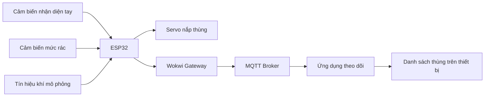

# 🗑️ Smart Trash Can

**Thùng rác thông minh với ESP32 và ứng dụng theo dõi trên điện thoại.**

Smart Trash Can kết hợp điều khiển nắp không tiếp xúc, theo dõi mức đầy và cảnh báo khí mô phỏng trong một hệ thống IoT. Thiết bị gửi dữ liệu qua MQTT để người dùng quan sát trạng thái và quản lý danh sách thùng rác bằng ứng dụng React Native.

Dự án sử dụng Wokwi để mô phỏng thiết bị, giúp tìm hiểu cách cảm biến, bộ điều khiển và ứng dụng phối hợp trong quy trình theo dõi và thu gom rác.

## 📑 Mục lục

- [Giới thiệu](#overview)
- [Chức năng](#features)
- [Công nghệ sử dụng](#technology)
- [Kiến trúc hệ thống](#architecture)
- [Thành phần mô phỏng](#components)
- [Cấu trúc dự án](#structure)
- [Hướng dẫn chạy](#getting-started)
- [Trải nghiệm demo](#demo)
- [Kiểm thử](#testing)
- [Hướng phát triển](#roadmap)

<a id="overview"></a>
## 🌱 Giới thiệu

Dự án hướng đến thao tác bỏ rác thuận tiện và theo dõi tình trạng thùng từ xa. Người dùng đưa tay đến gần để mở nắp; thiết bị giữ nắp mở khi tay còn trong vùng nhận diện và tự đóng khi tay rời đi. Cảm biến bên trong đo khoảng cách đến mặt rác để ước tính mức đầy.

Ứng dụng hiển thị nhiều thùng trong cùng danh sách, hỗ trợ tìm kiếm theo tên hoặc vị trí và lọc các thùng có cảnh báo. Người dùng có thể xem mức đầy, chỉ số khí mô phỏng và tình trạng cập nhật của từng thùng để chủ động kiểm tra, thu gom.

Phạm vi hiện tại là mô phỏng và demo. Chỉ số khí được tạo bằng biến trở; mức đầy là ước tính theo chiều cao thùng. Việc vận hành trên phần cứng thật và toàn bộ luồng thiết bị đến ứng dụng cần được kiểm chứng thêm.

<a id="features"></a>
## ✨ Chức năng

### Thiết bị ESP32

| Chức năng | Mô tả |
| --- | --- |
| 👋 Mở nắp không tiếp xúc | Nhận diện tay ở khoảng cách tối đa 20 cm, xác nhận liên tục 500 ms trước khi mở |
| ⏱️ Tự động đóng nắp | Giữ mở khi còn tay; đóng sau khoảng 3 giây khi tay rời vùng nhận diện |
| 📊 Theo dõi mức đầy | Ước tính phần trăm đầy từ khoảng cách tới mặt rác khi nắp đóng ổn định |
| 🔔 Cảnh báo đầy | Bật khi mức đầy đạt 80%, xóa khi giảm xuống 75% hoặc thấp hơn |
| 🌫️ Cảnh báo khí mô phỏng | Theo dõi tín hiệu analog và cảnh báo độc lập với mức đầy |
| 📡 Truyền dữ liệu MQTT | Gửi trạng thái, sự kiện và tình trạng kết nối |
| 🔄 Phục hồi kết nối | Tự thử kết nối lại; điều khiển nắp tiếp tục hoạt động khi mất mạng |
| 🛠️ Xử lý dữ liệu cảm biến | Phân biệt mẫu không hợp lệ và mẫu cũ; giữ nắp mở khi cảm biến tay lỗi lúc đang mở |

### Ứng dụng mobile

- **Quản lý danh sách:** thêm, sửa, xóa thông tin thùng và vị trí.
- **Tìm kiếm và lọc:** tìm theo tên/vị trí, lọc thùng có cảnh báo.
- **Theo dõi trực quan:** thanh mức đầy, chỉ số khí mô phỏng, cảnh báo và tổng quan danh sách.
- **Xem chi tiết:** thông tin thiết bị, lệnh nắp và thời gian nhận dữ liệu gần nhất.
- **Nhận biết trạng thái:** phân biệt mất kết nối, thiết bị offline, chờ dữ liệu và dữ liệu cũ.
- **Lưu danh sách:** giữ thông tin thùng trên thiết bị để sử dụng khi mở lại ứng dụng.
- **Chế độ minh họa:** trải nghiệm giao diện và cảnh báo mà không cần ESP32.

Ứng dụng nhận dữ liệu để theo dõi; việc đóng/mở nắp do firmware điều khiển tại thiết bị. Cảnh báo hiện hiển thị khi ứng dụng đang mở.

<a id="technology"></a>
## 🧰 Công nghệ sử dụng

| Nhóm | Công nghệ | Vai trò |
| --- | --- | --- |
| Vi điều khiển | ESP32 | Đọc cảm biến và điều khiển nắp |
| Firmware | C++, Arduino, FreeRTOS | Xử lý logic và tách tác vụ điều khiển với tác vụ mạng |
| Công cụ nhúng | PlatformIO | Quản lý thư viện và biên dịch firmware |
| Mô phỏng | Wokwi | Mô phỏng mạch và tương tác cảm biến |
| Kết nối IoT | MQTT, PubSubClient | Truyền trạng thái và sự kiện từ thiết bị |
| Ứng dụng | React Native, Expo, TypeScript | Xây dựng giao diện mobile và bản web tùy chọn |
| Nhận dữ liệu | MQTT.js, WebSocket | Kết nối ứng dụng với hệ thống MQTT |
| Lưu trữ trên thiết bị | AsyncStorage | Lưu danh sách thùng |
| Kiểm thử | g++, Node.js test runner, TypeScript | Kiểm tra logic firmware và mô hình dữ liệu ứng dụng |

<a id="architecture"></a>
## 🧭 Kiến trúc hệ thống



Firmware tách điều khiển cục bộ và xử lý mạng thành các tác vụ riêng. Dữ liệu truyền qua MQTT gồm trạng thái mới nhất, sự kiện thay đổi và tình trạng kết nối. Ứng dụng phân biệt dữ liệu mới với dữ liệu cũ để hỗ trợ người dùng đọc trạng thái đúng ngữ cảnh.

<a id="components"></a>
## 🔌 Thành phần mô phỏng

| Thành phần | Số lượng | Vai trò |
| --- | --- | --- |
| ESP32 | 1 | Bộ điều khiển trung tâm |
| HC-SR04 | 2 | Nhận diện tay và đo khoảng cách tới mặt rác |
| Servo | 1 | Đóng/mở nắp |
| Biến trở | 1 | Giả lập tín hiệu analog của cảm biến khí |

Sơ đồ mô phỏng nằm trong [diagram.json](diagram.json).

<a id="structure"></a>
## 📂 Cấu trúc dự án

```text
.
├── include/          # Khai báo và tham số firmware
├── src/              # Điều khiển nắp, cảm biến và truyền dữ liệu
├── mobile/           # Ứng dụng React Native + Expo
│   ├── App.tsx       # Giao diện ứng dụng
│   ├── src/          # Mô hình dữ liệu và kết nối
│   ├── assets/       # Tài nguyên hình ảnh
│   └── test/         # Kiểm thử logic ứng dụng
├── test/             # Kiểm thử logic firmware
├── scripts/          # Script hỗ trợ kiểm thử
├── docs/             # Tài liệu kỹ thuật
├── diagram.json      # Sơ đồ mạch mô phỏng
├── wokwi.toml        # Thiết lập mô phỏng
└── platformio.ini    # Thiết lập build firmware
```

<a id="getting-started"></a>
## 🚀 Hướng dẫn chạy

### 1. Chạy firmware trong Wokwi

Chuẩn bị **VS Code**, extension **PlatformIO IDE** và **Wokwi Simulator**. Mở thư mục gốc dự án, sau đó chạy trong PlatformIO terminal:

```sh
pio run
```

Sau khi build thành công, mở Command Palette và chọn **Wokwi: Start Simulator**. Quan sát mô phỏng và Serial Monitor để theo dõi hoạt động của nắp, cảm biến và cảnh báo.

### 2. Chạy ứng dụng mobile

Chuẩn bị **Node.js** tương thích với Expo SDK của dự án. Từ thư mục gốc:

```sh
cd mobile
npm ci
npm start
```

Dùng **Expo Go tương thích SDK** để quét mã QR khi điện thoại và máy tính cùng mạng Wi-Fi. Nếu Expo Go không tương thích, sử dụng development build.

Các lựa chọn khác, chạy trong thư mục `mobile/`:

| Môi trường | Lệnh |
| --- | --- |
| Android emulator đã khởi động | `npm run android` |
| iOS simulator trên macOS có Xcode | `npm run ios` |
| Trình duyệt | `npm run web` |

Nhấn `Ctrl+C` để dừng. Hướng dẫn mobile chi tiết nằm trong [mobile/README.md](mobile/README.md).

<a id="demo"></a>
## 🎮 Trải nghiệm demo

**Với ứng dụng:** bật **Chế độ minh họa**, thêm thùng demo có cảnh báo, thử tìm kiếm, lọc và mở chi tiết. Chế độ này sử dụng dữ liệu giả lập riêng để trải nghiệm giao diện.

**Với mô phỏng Wokwi:**

1. Đưa khoảng cách cảm biến tay về 10 cm và giữ trên 500 ms để mở nắp.
2. Giữ tay trong vùng nhận diện để quan sát nắp tiếp tục mở.
3. Đưa tay ra xa và chờ khoảng 3 giây để nắp đóng.
4. Khi nắp đã đóng, giảm khoảng cách tới mặt rác để quan sát mức đầy và cảnh báo.
5. Điều chỉnh biến trở để quan sát cảnh báo khí hoạt động độc lập.

Khi theo dõi dữ liệu từ mô phỏng, tắt chế độ minh họa trong ứng dụng. Chú ý trạng thái cập nhật và thời gian nhận dữ liệu khi đọc cảnh báo.

<a id="testing"></a>
## 🧪 Kiểm thử

Kiểm thử logic firmware trên máy tính cần `g++` trong PATH. Chạy tại thư mục gốc bằng PowerShell:

```powershell
powershell -NoProfile -ExecutionPolicy Bypass -File scripts/test.ps1
```

Kiểm tra TypeScript và mô hình dữ liệu mobile:

```sh
cd mobile
npm run typecheck
npm test
```

Các nhóm kiểm thử tập trung vào thời gian mở/đóng nắp, tay quay lại, lỗi cảm biến, tràn bộ đếm, cảnh báo độc lập, dữ liệu MQTT và trạng thái cập nhật. Kiểm thử logic cần được bổ sung bằng kiểm tra tương tác trên mô phỏng và thiết bị.

<a id="roadmap"></a>
## 🌿 Hướng phát triển

- Kiểm chứng toàn bộ luồng thiết bị, MQTT và ứng dụng trên điện thoại.
- Bổ sung lịch sử dữ liệu và thông báo đẩy.
- Mở rộng kiểm thử kết nối, lưu trữ và giao diện.
- Hoàn thiện phần cứng thật, hiệu chuẩn cảm biến và phản hồi trạng thái nắp.
