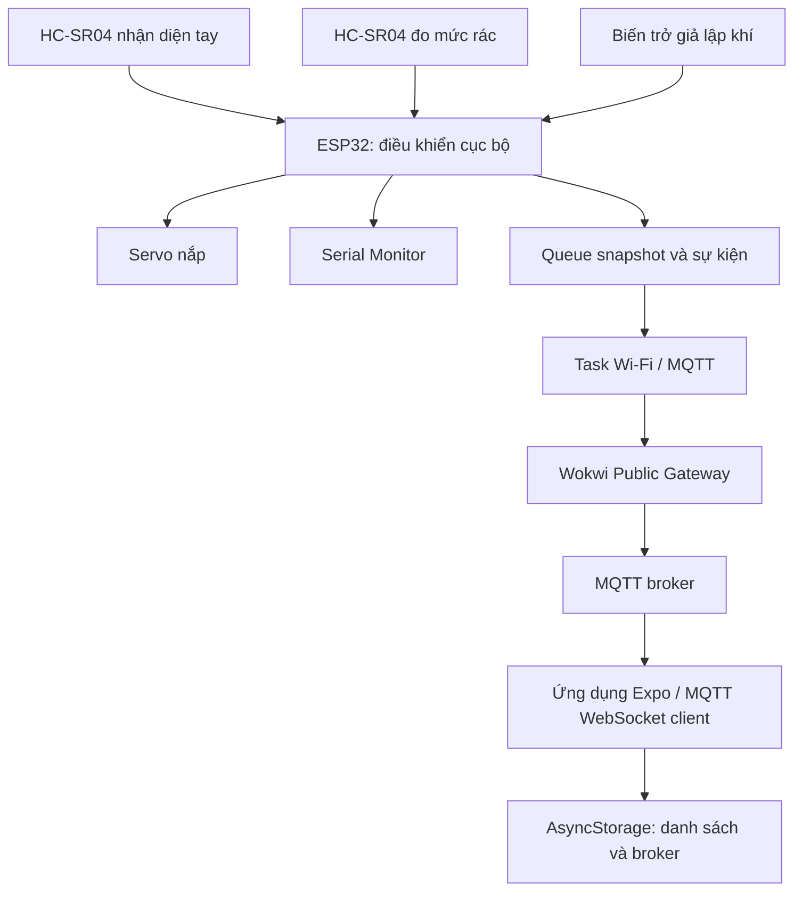

# Smart Trash Can — ESP32 IoT và ứng dụng mobile

Dự án mô phỏng thùng rác thông minh bằng ESP32, PlatformIO và Wokwi, kèm ứng dụng React Native + Expo để quản lý danh sách thùng và theo dõi MQTT.

**Audit local: 15/11/2026.** Đã có firmware và app; build/logic test pass. Chưa xác minh chạy tương tác Wokwi, điện thoại/emulator hoặc toàn bộ luồng ESP32 → broker → app. Đây là bản phục vụ mô phỏng/demo, chưa phải bản triển khai production.

## Mục lục

1. [Kết quả audit và tiến độ](#audit)
2. [Kiến trúc và công nghệ](#architecture)
3. [Cấu trúc dự án](#structure)
4. [Chức năng và cấu hình firmware](#firmware)
5. [Chức năng mobile](#mobile)
6. [Hướng dẫn chạy firmware và Wokwi](#run-firmware)
7. [Hướng dẫn chạy ứng dụng mobile](#run-mobile)
8. [Kết nối MQTT và dữ liệu](#mqtt)
9. [Kiểm thử và kết quả xác minh](#tests)
10. [Giới hạn và việc cần làm tiếp](#remaining)
11. [Xử lý sự cố](#troubleshooting)
12. [Tài liệu liên quan](#docs)

<a id="audit"></a>
## 1. Kết quả audit và tiến độ

Đối chiếu mã nguồn, cấu hình, test và tài liệu trong working tree. “Đã triển khai” nghĩa là có code, không đồng nghĩa đã kiểm chứng trên phần cứng.

| Thứ tự | Hạng mục | Đã triển khai | Mức xác minh |
| --- | --- | --- | --- |
| 1 | Điều khiển nắp | Máy trạng thái, xác nhận tay, giữ mở, tự đóng, giữ mở khi cảm biến tay lỗi | Host test pass; chuyển động servo chưa xác minh |
| 2 | Driver cảm biến | Echo bằng ISR, timeout, xen kẽ hai HC-SR04, đọc ADC | Build pass; ISR/nhiễu chéo cần chạy runtime |
| 3 | Môi trường | Quy đổi mức đầy, hai cảnh báo đầy/khí độc lập có hysteresis, mẫu invalid/stale | Host test pass; khí là biến trở mô phỏng |
| 4 | Wi-Fi/MQTT | Task FreeRTOS riêng, reconnect/backoff, JSON, state/events/availability | Build pass; chưa xác minh gateway và reconnect end-to-end |
| 5 | Mô phỏng | Sơ đồ ESP32, 2 HC-SR04, servo, biến trở và cấu hình BIN/ELF | Có cấu hình; W01–W12 còn chờ chạy |
| 6 | App quản lý | Danh sách/chi tiết, thêm/sửa/xóa, tìm kiếm, lọc cảnh báo, thống kê | Có giao diện; chưa chạy điện thoại/emulator trong audit |
| 7 | App theo dõi | MQTT WSS, kiểm tra schema/device ID, trạng thái offline/cũ, reconnect theo lifecycle | Typecheck và model test pass; hook MQTT/UI chưa có test tự động |
| 8 | Lưu trữ và demo | AsyncStorage lưu danh sách/broker; demo tách khỏi MQTT | Có code; lưu trữ và foreground/background cần kiểm tra thực tế |
| 9 | Đóng gói và tài liệu | Hướng dẫn Expo Go, emulator, native và EAS APK | Chưa có eas.json, APK/IPA, backend hoặc triển khai production |

<a id="architecture"></a>
## 2. Kiến trúc và công nghệ



- Vòng điều khiển trên core 1 dùng `millis()`; echo bắt cạnh bằng ngắt và `micros()`, không chờ bằng `pulseIn()`.
- Task mạng trên core 0 nhận dữ liệu qua queue; chờ kết nối mạng diễn ra trong task riêng. Trigger siêu âm có chờ cố định khoảng 12 µs, vòng điều khiển nhường CPU bằng `delay(1)`.
- Gateway nối ESP32 mô phỏng ra Internet, không cần thêm board gateway vật lý. App kết nối trực tiếp broker; chưa có backend.

| Thành phần | Phiên bản/cấu hình trong repository |
| --- | --- |
| Board | ESP32, PlatformIO `esp32dev` |
| Firmware | `espressif32 @ 7.0.1`, Arduino-ESP32 2.0.17 |
| MQTT firmware | PubSubClient 2.8; TCP 1883 mặc định |
| Servo | LEDC 50 Hz, 16-bit; API Arduino core 2.x |
| Serial | 115200 baud |
| Mobile | Expo ~58.0.23, React 19.3.0, React Native 0.88.1, TypeScript ~6.0.3 |
| MQTT mobile / lưu cấu hình | MQTT.js ^5.16.1 / AsyncStorage 2.2.0 |
| Kiểm thử | MinGW g++ C++11; Node test runner; TypeScript |

<a id="structure"></a>
## 3. Cấu trúc dự án

```text
.
├── include/Config.h               # GPIO, ngưỡng và chu kỳ
├── include/Secrets.example.h      # Cấu hình kết nối demo
├── src/main.cpp                   # Lịch cảm biến và điều phối
├── src/LidController.h            # Máy trạng thái nắp
├── src/EnvironmentMonitor.h       # Mức rác và cảnh báo
├── src/UltrasonicSensor.h/.cpp    # ISR echo và timeout
├── src/Telemetry.h/.cpp           # Snapshot, queue, Wi-Fi và MQTT
├── test/test_logic.cpp            # 5 nhóm host test
├── scripts/test.ps1               # Build và chạy host test
├── mobile/
│   ├── App.tsx                    # Danh sách, chi tiết, biểu mẫu và demo
│   ├── src/model.ts               # Decode, trạng thái và kiểm tra cấu hình
│   ├── src/useMonitor.ts          # MQTT, AsyncStorage, lifecycle
│   ├── test/model.test.ts         # 5 test model
│   ├── app.json                   # Cấu hình Expo và icon
│   ├── package.json               # Dependencies và lệnh chạy
│   └── README.md                  # Hướng dẫn mobile chi tiết và APK
├── docs/TEST_CASES.md              # Kết quả cũ và ca runtime W01–W12
├── docs/MOBILE_PLAN.md             # Phạm vi mobile
├── diagram.json                   # Mạch Wokwi
├── wokwi.toml                     # Đường dẫn BIN/ELF
├── platformio.ini                 # Board, framework, thư viện
└── KE_HOACH_CODE.md                # Kế hoạch firmware
```

<a id="firmware"></a>
## 4. Chức năng và cấu hình firmware

| Chức năng/tham số | Hành vi mặc định |
| --- | --- |
| Mở không tiếp xúc | Tay ≤20 cm liên tục 500 ms |
| Giữ mở / tự đóng | Còn tay thì giữ mở; đóng sau khoảng 3 giây từ lần thấy tay cuối khi xác nhận vùng tay trống |
| Tay quay lại | Hủy đếm đóng |
| Cảm biến tay lỗi | Hủy xác nhận mở; nếu đang mở thì giữ mở đến khi có mẫu hợp lệ |
| Đo rác | Mỗi 2000 ms khi nắp đóng ổn định ít nhất 500 ms |
| Hai cảm biến siêu âm | Luân phiên, khoảng nghỉ ≥60 ms, timeout echo 30000 µs; mẫu hợp lệ 2–400 cm |
| Tuổi mẫu | Tay tối đa 250 ms; rác quá 5000 ms được đánh dấu cũ |
| Cảnh báo đầy | Bật ≥80%, tắt ≤75%; mẫu lỗi giữ cờ cảnh báo trước đó |
| Khí mô phỏng | ADC 12-bit, đọc mỗi 100 ms; bật >2000, tắt ≤1800 |
| Servo | Xung đóng 500 µs, mở 1450 µs |
| Telemetry | State mỗi 2 giây và khi xử lý sự kiện |

Máy trạng thái: `CLOSED → CONFIRMING → OPEN → WAITING_TO_CLOSE → CLOSED`. Phép trừ thời gian unsigned xử lý tràn bộ đếm; thời điểm lệnh còn phụ thuộc lịch lấy mẫu, không phải phản hồi vị trí servo.

```text
mức đầy (%) = clamp(100 × (1 − khoảng cách / 40 cm), 0, 100)
```

40 cm → 0%, 20 cm → 50%, khoảng 8 cm → 80%. Đây là ước tính theo chiều cao, chưa phải thể tích thực tế. Mở nắp đánh dấu dữ liệu rác cũ đến phép đo mới sau đóng ổn định.

| Linh kiện | GPIO ESP32 |
| --- | --- |
| HC-SR04 tay `hand` | TRIG 5, ECHO 18 |
| HC-SR04 rác `trash` | TRIG 12, ECHO 14 |
| Servo `lid` | PWM 13 |
| Biến trở `gas` | SIG 34 |

Mạch mô phỏng cấp 5 V cho HC-SR04/servo, 3,3 V cho biến trở và chung GND. Xem [diagram.json](diagram.json); chuyển sang mạch thật cần kiểm tra điện áp echo/ADC, nguồn servo và chân boot.

<a id="mobile"></a>
## 5. Chức năng mobile

- Danh sách và chi tiết thùng: mức đầy, thanh phần trăm, ADC khí, cảnh báo đầy/khí, lệnh nắp và thời gian nhận cuối.
- Thêm/sửa/xóa tên, vị trí, device ID, topic root; kiểm tra trống, trùng ID/topic và wildcard topic.
- Tìm theo tên/vị trí, lọc thùng có cảnh báo, tổng số thùng và số thùng có cảnh báo.
- Lưu danh sách và broker trên thiết bị bằng AsyncStorage; cho đổi URL WSS, không lưu tài khoản/mật khẩu broker.
- Nhận `state`, `events`, `availability`; kiểm tra schema 1, device ID, kiểu dữ liệu và miền giá trị. Cảnh báo dùng cờ firmware, không tự tính lại ngưỡng.
- Phân biệt mất broker, thiết bị offline, chờ dữ liệu và dữ liệu cũ. Retained state chưa được coi là dữ liệu sống; không có mẫu mới quá 15 giây thì đánh dấu cũ.
- Khi app xuống nền, kết nối được dọn; trở lại foreground thì kết nối lại. Danh sách thay đổi hoặc đổi broker sẽ tạo lại kết nối và xóa readings hiện tại.
- Chế độ minh họa tách MQTT, cập nhật mỗi 2 giây; có nút thêm thùng demo cảnh báo. Tắt demo xóa readings giả, nhưng thùng demo vẫn trong danh sách để người dùng xóa.

App chỉ theo dõi; không gửi lệnh điều khiển nắp. Chưa có lịch sử telemetry, tài khoản, push hoặc backend.

<a id="run-firmware"></a>
## 6. Hướng dẫn chạy firmware và Wokwi

### Bước 1 — Chuẩn bị

Cài VS Code, extension PlatformIO IDE và Wokwi Simulator. Mở thư mục gốc repository. Nếu Wokwi yêu cầu kích hoạt, thực hiện trong extension và giữ license ngoài Git.

### Bước 2 — Cấu hình kết nối

Mặc định dùng `include/Secrets.example.h`: Wi-Fi `Wokwi-GUEST`, mật khẩu rỗng, broker `broker.hivemq.com:1883`.

Để dùng cấu hình riêng:

```powershell
Copy-Item include/Secrets.example.h include/Secrets.h
```

Chỉnh `WIFI_SSID`, `WIFI_PASSWORD`, `MQTT_HOST`, `MQTT_PORT`, `MQTT_USER`, `MQTT_PASSWORD`, `DEVICE_ID`, `MQTT_TOPIC_ROOT`. `Secrets.h` được Git bỏ qua. Mỗi thiết bị chạy đồng thời cần ID/topic riêng; sửa ID/topic trong app tương ứng. GPIO/ngưỡng nằm trong `include/Config.h`.

### Bước 3 — Build

Từ PlatformIO terminal tại gốc repository:

```powershell
pio run
```

Hoặc dùng nút **Build**. Lần đầu cần mạng để tải toolchain/dependencies. Kết quả là `.pio/build/esp32dev/firmware.bin` và `firmware.elf`, khớp `wokwi.toml`.

Nếu dùng bộ công cụ local `.pio/core` như môi trường audit Windows này:

```powershell
$env:PLATFORMIO_CORE_DIR = Join-Path (Get-Location) '.pio/core'
pio run
```

Đây là tùy chọn cho môi trường có toolchain local, không bắt buộc trên máy đã cài PlatformIO bình thường.

### Bước 4 — Chạy và thử

Nhấn **F1 → Wokwi: Start Simulator**. Xem Serial: `[BOOT]`, `[LID ...]`, `[STATE ...]`, `[NET]`.

| Thao tác | Kết quả cần quan sát |
| --- | --- |
| `hand`: 50 → 10 cm, giữ >500 ms | Nắp mở |
| Giữ tay 10 cm >3 giây | Nắp vẫn mở |
| `hand`: về 50 cm | Khoảng 3 giây sau gửi lệnh đóng |
| Khi nắp đóng, `trash`: về 7 cm | Sau lượt đo bật cảnh báo đầy |
| `trash`: về 12 cm | Xóa cảnh báo đầy |
| Tăng biến trở đến ADC >2000 | Bật gas_high độc lập với đầy |
| Giảm ADC ≤1800 | Xóa gas_high |

Dùng 7 cm để demo báo đầy, tránh sai số lượng tử ở đúng ngưỡng 8 cm. Build lại và khởi động lại mô phỏng sau mỗi lần đổi code/cấu hình.

<a id="run-mobile"></a>
## 7. Hướng dẫn chạy ứng dụng mobile

Cài Node.js tương thích Expo SDK trong `mobile/package.json`. Từ gốc repository:

```powershell
cd mobile
npm ci
npm start
```

Điện thoại và máy tính cùng Wi-Fi, dùng Expo Go tương thích SDK rồi quét QR trong terminal. Nếu Expo Go chưa hỗ trợ SDK này, cần development build tương thích.

| Môi trường | Cách chạy từ mobile/ |
| --- | --- |
| Android emulator | Cài Android Studio, tạo/mở máy ảo trong Device Manager, chạy `npm run android` |
| Android native qua USB/emulator | Chuẩn bị Android SDK/JDK và thiết bị, chạy `npx expo run:android --device` |
| iOS simulator | Trên macOS có Xcode: `npm run ios` |
| Web tùy chọn | `npm run web`, mở URL local CLI trả về |
| APK cài độc lập | Xem [hướng dẫn EAS APK](mobile/README.md#build-apk-cài-độc-lập); chưa có APK hoặc eas.json trong tree |

Nhấn `Ctrl+C` để dừng; xóa cache bằng `npm start -- --clear`. Nếu PowerShell chặn `npm.ps1`, dùng `npm.cmd`.

**Demo không cần ESP32:** bật “Chế độ minh họa”, thêm thùng demo có cảnh báo, thử tìm kiếm/lọc và mở chi tiết. Tắt demo để nhận MQTT thật.

**Chạy cùng firmware:** giữ app ở foreground, tắt demo, kiểm tra broker và sửa device ID/topic root khớp firmware; chạy Wokwi, chờ bản tin mới rồi đối chiếu Serial với app. Topic root không thêm `/#`.

Hướng dẫn thiết lập Android Studio, USB, APK, iOS và khắc phục chi tiết nằm trong [mobile/README.md](mobile/README.md).

<a id="mqtt"></a>
## 8. Kết nối MQTT và dữ liệu

| Cấu hình mặc định | Giá trị |
| --- | --- |
| ESP32 TCP | `broker.hivemq.com:1883`, không TLS |
| App / client WebSocket | `wss://broker.hivemq.com:8884/mqtt` |
| Device ID | `nhom10-trash-7c91a2` |
| Topic root | `nhom10/trash/nhom10-trash-7c91a2` |

Để xem bằng trình duyệt, mở [HiveMQ WebSocket Client](https://www.hivemq.com/demos/websocket-client/), nhập host `broker.hivemq.com`, port `8884`, bật SSL, dùng ClientID riêng, để trống user/password với broker demo rồi Connect. Subscribe `<topic-root>/#`. Không đổi firmware sang port WebSocket.

| Topic | Nội dung | Retained |
| --- | --- | --- |
| `<root>/state` | Snapshot mới nhất định kỳ 2 giây và sau xử lý sự kiện | Có |
| `<root>/events` | Snapshot khi lệnh nắp, cảnh báo hoặc tính hợp lệ/stale thay đổi | Không |
| `<root>/availability` | `online` khi kết nối, `offline` qua Last Will khi mất kết nối | Có |

State/events dùng QoS 0. Ví dụ minh họa schema, không phải log runtime:

```json
{
  "schema": 1,
  "device_id": "nhom10-trash-7c91a2",
  "sequence": 3,
  "uptime_ms": 20000,
  "lid_command": "closed",
  "hand_cm": 50.0,
  "hand_valid": true,
  "hand_age_ms": 20,
  "fill_percent": 50.0,
  "trash_valid": true,
  "trash_stale": false,
  "trash_age_ms": 400,
  "gas_adc": 1200,
  "gas_valid": true,
  "full": false,
  "gas_high": false
}
```

`sequence` đếm thay đổi được ghi nhận; `uptime_ms` là thời gian từ khi firmware khởi động. `lid_command` là lệnh gửi servo, chưa phải phản hồi vị trí cơ khí. `null` nghĩa là chưa có mẫu/mẫu lỗi, không phải 0. `trash_stale=true` nghĩa là mức đầy có thể là mẫu cũ. Cờ báo đầy giữ nguyên khi cảm biến rác lỗi, nên phải đọc cùng trạng thái dữ liệu.

Retained state có thể thuộc phiên trước. Theo dõi availability, uptime và bản tin mới; Last Will có độ trễ phát hiện offline. Mất broker không đủ để kết luận riêng thiết bị đã offline.

Wi-Fi retry mỗi 10 giây, MQTT backoff tối đa 30 giây. Queue snapshot giữ giá trị mới nhất; queue sự kiện tối đa 12 phần tử RAM, có thể bỏ sự kiện cũ và xóa trước lượt kết nối MQTT mới. Reconnect ưu tiên trạng thái hiện tại, không khôi phục toàn bộ lịch sử.

<a id="tests"></a>
## 9. Kiểm thử và kết quả xác minh

### Lệnh kiểm tra

Cần MinGW `g++` trên PATH. Từ gốc repository:

```powershell
powershell -NoProfile -ExecutionPolicy Bypass -File scripts/test.ps1
```

Script biên dịch C++11 với `-Wall -Wextra -Werror`. Mobile:

```powershell
cd mobile
npm run typecheck
npm test
```

Để kiểm tra đóng gói web riêng: `npx expo export --platform web` tại `mobile/`. Export bundle không phải APK/IPA.

### Kết quả chạy lại ngày 15/11/2026

| Kiểm tra | Kết quả |
| --- | --- |
| PlatformIO ESP32 build | SUCCESS; RAM tĩnh 45.704/327.680 byte (13,9%), flash 764.737/1.310.720 byte (58,3%) |
| Host logic C++ | PASS, 5 nhóm: timing, tay quay lại, cảm biến lỗi, tràn thời gian, cảnh báo độc lập |
| Mobile TypeScript | PASS |
| Mobile model | PASS, 5/5: schema/cảnh báo, dữ liệu lỗi, mẫu null, trạng thái retained/cũ/offline, cấu hình trùng/wildcard |
| Mobile lint | Chưa có script/config lint; chưa chạy |
| Wokwi W01–W12, điện thoại/emulator, MQTT end-to-end | Chưa chạy trong audit |

Node có cảnh báo `MODULE_TYPELESS_PACKAGE_JSON` khi chạy model test nhưng test vẫn pass. Test model chưa bao phủ hook MQTT, AsyncStorage, lifecycle hoặc giao diện. RAM build chưa bao gồm tất cả heap/stack runtime.

[docs/TEST_CASES.md](docs/TEST_CASES.md) giữ báo cáo firmware ngày 05/11/2026 và danh sách ca runtime. [mobile/README.md](mobile/README.md) giữ báo cáo ngày 11/11/2026 về export web/Android/iOS và dependency compatibility; các bước đó chưa được chạy lại trong audit này.

<a id="remaining"></a>
## 10. Giới hạn và việc cần làm tiếp

Ưu tiên theo thứ tự:

1. Chạy W01–W12, lưu ảnh/log; xác minh servo, ISR, timeout, hai core, mất mạng/reconnect và Last Will. Tiếp theo chạy ESP32 → broker → app trên điện thoại/emulator.
2. Kiểm tra thêm/sửa/xóa, lưu và mở lại app, foreground/background, JSON lỗi, ID/topic sai, mẫu invalid/stale. Cấu hình đọc từ AsyncStorage hiện chỉ kiểm tra kiểu mảng/chuỗi và tiền tố WSS, chưa tái dùng toàn bộ kiểm tra trùng ID/topic và URL của biểu mẫu.
3. Rà soát cách hiển thị cảnh báo cũ: app vẫn hiển thị/đếm cờ cảnh báo cuối khi thiết bị offline hoặc dữ liệu cũ. Luôn đọc kèm trạng thái/thời gian, không coi là cảnh báo mới được xác nhận.
4. Bổ sung lint và kiểm thử kết nối/lưu trữ/UI khi phát triển tiếp. Chưa có cấu hình EAS/signing hoặc artifact APK/IPA.
5. Nếu cần triển khai riêng: thiết kế xác thực, phân quyền broker và TLS firmware, backend/lịch sử bền, push. App hiện không có form tài khoản/mật khẩu broker; không có tài khoản hay đồng bộ giữa thiết bị.
6. Kiểm tra lại dependency advisory trước phát hành. Báo cáo mobile ngày 11/11/2026 ghi 5 cảnh báo moderate; audit này chưa chạy lại kiểm tra advisory trực tuyến nên không kết luận số lượng hiện tại.

Public broker dùng chung chỉ phục vụ demo, topic không phải quyền truy cập riêng. Không đưa mật khẩu thật, token, license, keystore hoặc dữ liệu cá nhân vào README/Git hay topic công cộng. Chỉ đổi cổng firmware sang 8883 chưa đủ để có TLS; cần transport và xác minh chứng thư.

Biến trở không phải MQ-135 thực tế, không quy đổi ppm hoặc kết luận độc hại. Chưa có phản hồi vị trí servo, cảm biến chống kẹt, hiệu chuẩn phần cứng hoặc AI chạy trên ESP32. Mạch mô phỏng chưa phải hướng dẫn đấu nối thiết bị thật. Public Gateway của Wokwi không truy cập LAN.

<a id="troubleshooting"></a>
## 11. Xử lý sự cố

| Hiện tượng | Cách kiểm tra |
| --- | --- |
| Không nhận pio | Mở PlatformIO terminal hoặc dùng nút Build |
| Không tìm thấy firmware Wokwi | Build trước, kiểm tra env esp32dev và wokwi.toml |
| Wokwi yêu cầu license | Kích hoạt trong extension, giữ license riêng |
| App không mở bằng Expo Go | Kiểm tra SDK tương thích; dùng development build khi cần |
| Android không tìm thấy thiết bị | Khởi động emulator, kiểm tra Android SDK/PATH hoặc USB debugging và `adb devices` |
| Không nhận MQTT | Tắt demo, kiểm tra log NET, broker, device ID, topic root; app dùng WSS 8884, firmware TCP 1883 |
| Hai ESP32 làm rớt kết nối nhau | Dùng DEVICE_ID riêng, ClientID app/trình duyệt cũng phải khác |
| Mức đầy không đổi khi mở nắp | Hành vi dự kiến; chờ đóng ổn định và lượt đo mới |
| Mức đầy null | Kiểm tra echo và valid; không coi là thùng rỗng |
| Chưa thấy offline ngay | Chờ broker phát hiện mất kết nối và phát Last Will |
| Broker LAN không kết nối từ Wokwi | Public Gateway không truy cập LAN; cần gateway/đường mạng phù hợp |
| Nâng Arduino core bị lỗi LEDC | Giữ core 2.x đã cố định hoặc cập nhật driver theo API mới |

<a id="docs"></a>
## 12. Tài liệu liên quan

- [Hướng dẫn mobile và APK](mobile/README.md).
- [Phạm vi mobile](docs/MOBILE_PLAN.md), [kế hoạch firmware](KE_HOACH_CODE.md).
- [Ca kiểm thử runtime Wokwi](docs/TEST_CASES.md).
- [Wokwi PlatformIO](https://docs.wokwi.com/vscode/platformio), [Wi-Fi/Gateway](https://docs.wokwi.com/guides/esp32-wifi).
- [HiveMQ broker demo](https://www.hivemq.com/mqtt/public-mqtt-broker/), [WebSocket client](https://www.hivemq.com/demos/websocket-client/).
- [PubSubClient](https://github.com/knolleary/pubsubclient), [MQTT.js](https://github.com/mqttjs/MQTT.js).
