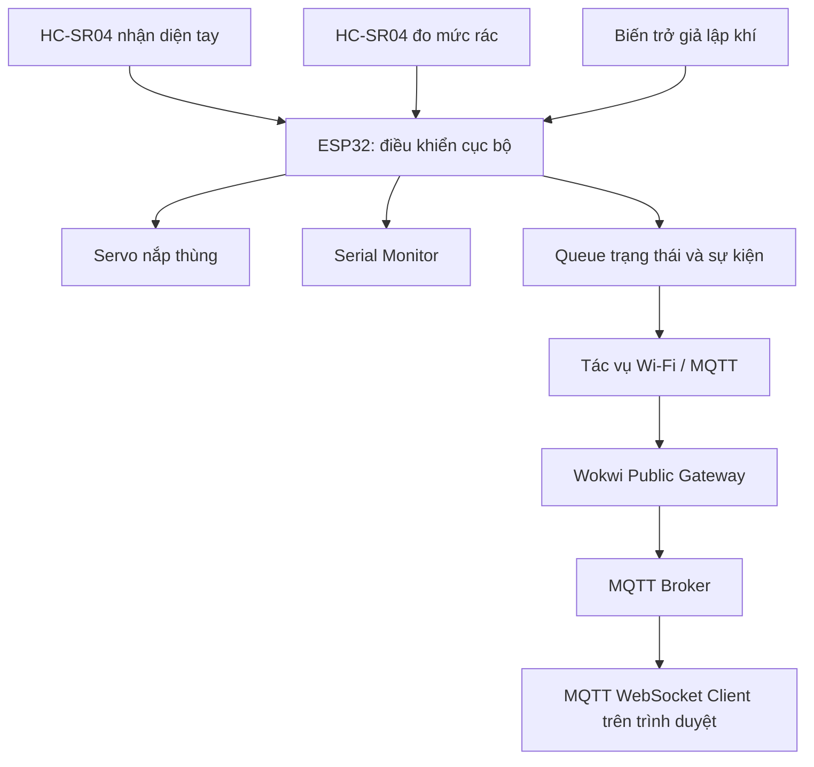

# 🗑️ Smart Trash Can — ESP32 IoT

Mô phỏng thùng rác thông minh với **ESP32**, **PlatformIO** và **Wokwi**: tự động đóng/mở nắp, theo dõi mức rác, cảnh báo chỉ số khí và truyền trạng thái qua MQTT để xem trên trình duyệt.

> **Trạng thái:** firmware đã build thành công và kiểm thử logic trên máy tính đã pass. Các ca chạy tương tác Wokwi, servo và nhận MQTT từ thiết bị mô phỏng còn chờ xác minh. Chi tiết tại [bảng kiểm thử](docs/TEST_CASES.md).

## 📑 Nội dung

- [Chức năng](#-chức-năng)
- [Kiến trúc](#-kiến-trúc)
- [Công nghệ và linh kiện](#-công-nghệ-và-linh-kiện)
- [Cấu trúc dự án](#-cấu-trúc-dự-án)
- [Cài đặt và chạy](#-cài-đặt-và-chạy)
- [Theo dõi MQTT trên trình duyệt](#-theo-dõi-mqtt-trên-trình-duyệt)
- [Thuật toán và cấu hình](#-thuật-toán-và-cấu-hình)
- [Kiểm thử](#-kiểm-thử)
- [Xử lý sự cố](#-xử-lý-sự-cố)
- [Bảo mật và giới hạn](#-bảo-mật-và-giới-hạn)

## ✨ Chức năng

| Chức năng | Hành vi |
| --- | --- |
| Mở nắp không tiếp xúc | Tay cách cảm biến ≤20 cm liên tục 500 ms thì gửi lệnh mở servo |
| Giữ nắp mở | Còn tay trong vùng nhận diện thì giữ mở |
| Tự đóng nắp | Đóng sau khoảng 3 giây khi tay rời vùng nhận diện; tay quay lại sẽ hủy đếm đóng |
| Theo dõi mức rác | Đo khoảng cách mỗi 2 giây khi nắp đóng ổn định, ước tính mức đầy 0–100% |
| Cảnh báo đầy | Bật khi mức rác ≥80%, xóa khi giảm xuống ≤75% |
| Cảnh báo khí | Bật khi ADC >2000, xóa khi ADC ≤1800; hoạt động độc lập với cảnh báo đầy |
| Theo dõi từ xa | Gửi trạng thái, sự kiện và tình trạng kết nối qua MQTT |
| Hoạt động khi mất mạng | Điều khiển nắp tiếp tục; tác vụ mạng tự thử kết nối lại |
| Nhận biết dữ liệu lỗi | Đánh dấu mẫu không hợp lệ hoặc đã cũ, tránh suy ra thùng rỗng khi cảm biến lỗi |

Chỉ số khí trong mô phỏng được tạo bằng **biến trở**, chưa phải phép đo MQ-135 thực tế.

## 🧭 Kiến trúc



- **Điều khiển cục bộ:** vòng lặp trên core 1 đọc cảm biến và điều khiển servo; các mốc thời gian dùng `millis()`.
- **Đo siêu âm:** bắt cạnh echo bằng ngắt và timestamp `micros()`, có timeout. Hai cảm biến phát luân phiên để giảm nguy cơ nhiễu chéo.
- **Truyền dữ liệu:** tác vụ FreeRTOS riêng trên core 0 xử lý Wi-Fi/MQTT và nhận dữ liệu qua queue. Kết nối mạng có thể chờ trong tác vụ này.
- **Gateway:** đưa kết nối của ESP32 mô phỏng ra mạng; không cần thêm một board gateway vật lý.
- **Broker:** nhận và phân phối bản tin MQTT. Trình duyệt kết nối broker bằng MQTT qua WebSocket để xem dữ liệu.

Vòng điều khiển không dùng `pulseIn()` để chờ echo. Xung trigger có thời gian chờ cố định khoảng 12 µs và vòng lặp có lệnh nhường CPU cho RTOS.

## 🧰 Công nghệ và linh kiện

### Phần mềm

| Thành phần | Cấu hình hiện tại |
| --- | --- |
| Vi điều khiển | ESP32, PlatformIO board `esp32dev` |
| Framework | Arduino-ESP32 2.0.17 |
| PlatformIO platform | `espressif32 @ 7.0.1` |
| MQTT client | `knolleary/PubSubClient @ 2.8` |
| Điều khiển servo | PWM LEDC tích hợp, 50 Hz, độ phân giải 16-bit |
| Mô phỏng | Wokwi Simulator for VS Code |
| Serial Monitor | 115200 baud |
| Kiểm thử logic | MinGW `g++`, C++11, PowerShell |

### Linh kiện và chân tín hiệu

| Linh kiện mô phỏng | Vai trò | GPIO ESP32 |
| --- | --- | --- |
| HC-SR04 `hand` | Nhận diện tay phía ngoài | TRIG 5, ECHO 18 |
| HC-SR04 `trash` | Đo khoảng cách tới mặt rác | TRIG 12, ECHO 14 |
| Servo `lid` | Đóng/mở nắp | PWM 13 |
| Biến trở `gas` | Giả lập tín hiệu khí analog | SIG 34 |

Sơ đồ mô phỏng cấp 5 V cho hai HC-SR04 và servo, 3,3 V cho biến trở; các linh kiện dùng chung GND. Xem [diagram.json](diagram.json) để biết toàn bộ kết nối. Chuyển sang mạch thật cần rà soát nguồn và mức điện áp riêng.

## 📂 Cấu trúc dự án

```text
.
├── include/
│   ├── Config.h                 # Chân, ngưỡng và chu kỳ
│   └── Secrets.example.h        # Cấu hình kết nối mẫu, không chứa khóa riêng
├── src/
│   ├── main.cpp                 # Khởi tạo, lịch đo và điều phối
│   ├── LidController.h          # Máy trạng thái nắp
│   ├── EnvironmentMonitor.h     # Mức rác và hai cảnh báo
│   ├── UltrasonicSensor.h/.cpp  # Bắt echo bằng ngắt và timeout
│   └── Telemetry.h/.cpp         # Snapshot, queue, Wi-Fi và MQTT
├── test/test_logic.cpp          # Kiểm thử logic độc lập phần cứng
├── scripts/test.ps1             # Biên dịch và chạy host test
├── docs/TEST_CASES.md            # Kết quả đã chạy và các ca chờ kiểm chứng
├── diagram.json                 # Sơ đồ mạch Wokwi
├── wokwi.toml                   # Đường dẫn BIN/ELF cho simulator
├── platformio.ini               # Board, framework và dependency
└── KE_HOACH_CODE.md              # Kế hoạch triển khai
```

## 🚀 Cài đặt và chạy

### 1. Chuẩn bị

Cài VS Code cùng hai extension:

- [PlatformIO IDE](https://marketplace.visualstudio.com/items?itemName=platformio.platformio-ide).
- [Wokwi Simulator](https://marketplace.visualstudio.com/items?itemName=Wokwi.wokwi-vscode).

Nếu Wokwi yêu cầu kích hoạt, thực hiện theo hướng dẫn của extension. License là cấu hình riêng của môi trường, không đưa vào repository.

### 2. Build firmware

Mở thư mục dự án trong VS Code. Từ PlatformIO terminal, chạy:

```powershell
pio run
```

Hoặc dùng nút **Build** của PlatformIO. Lần đầu cần kết nối mạng để tải công cụ và thư viện chưa có trên máy.

Khi build thành công, PlatformIO tạo:

```text
.pio/build/esp32dev/firmware.bin
.pio/build/esp32dev/firmware.elf
```

Hai đường dẫn này được khai báo trong [wokwi.toml](wokwi.toml). Build lại sau mỗi lần thay đổi code hoặc cấu hình.

### 3. Mở mô phỏng

Nhấn **F1** → chọn **Wokwi: Start Simulator**. Theo dõi Serial Monitor:

- `[BOOT]`: firmware khởi động.
- `[LID ...]`: thay đổi lệnh đóng/mở servo.
- `[STATE ...]`: trạng thái cảm biến và cảnh báo.
- `[NET]`: kết nối Wi-Fi/MQTT hoặc thông tin thử lại.

### 4. Thử nhanh

| Thao tác | Kết quả cần quan sát |
| --- | --- |
| Chỉnh `hand` từ 50 xuống 10 cm, giữ trên 500 ms | Nắp chuyển sang mở |
| Giữ `hand` ở 10 cm lâu hơn 3 giây | Nắp tiếp tục mở |
| Chỉnh `hand` về 50 cm | Khoảng 3 giây sau gửi lệnh đóng |
| Khi nắp đóng, chỉnh `trash` về 7 cm | Sau lượt đo, bật cảnh báo đầy |
| Giảm mức đầy bằng cách chỉnh `trash` về 12 cm | Xóa cảnh báo đầy |
| Tăng biến trở đến khi Serial có `gas > 2000` | Bật `gas_high`, kể cả rác chưa đầy |
| Giảm biến trở đến `gas <= 1800` | Xóa cảnh báo khí |

Dùng 7 cm để demo báo đầy thay vì đặt đúng 8 cm, tránh sai số lượng tử ngay tại ngưỡng.

## 🌐 Theo dõi MQTT trên trình duyệt

### Kết nối

Mở trực tiếp [HiveMQ MQTT WebSocket Client](https://www.hivemq.com/demos/websocket-client/). Luồng demo với broker công cộng không yêu cầu tạo tài khoản.

| Trường | Giá trị |
| --- | --- |
| Host | `broker.hivemq.com` |
| Port | `8884` |
| SSL | Bật |
| ClientID | ID riêng cho trình duyệt, khác `DEVICE_ID` của ESP32 |
| Username / Password | Để trống với broker demo mặc định |
| Clean Session | Bật |

Bấm **Connect**, sau đó **Add New Topic Subscription**. Lấy giá trị `MQTT_TOPIC_ROOT` trong cấu hình đang dùng và thêm `/#` để nhận toàn bộ topic của thiết bị.

Ví dụ với topic root minh họa `demo/trash/device-a`, đăng ký:

```text
demo/trash/device-a/#
```

Ví dụ này chỉ có tác dụng khi firmware cũng được cấu hình đúng topic đó. Nếu chưa tạo cấu hình riêng, lấy topic root mặc định từ [Secrets.example.h](include/Secrets.example.h).

Nếu ứng dụng MQTT khác yêu cầu URL đầy đủ, dùng:

```text
wss://broker.hivemq.com:8884/mqtt
```

ESP32 dùng MQTT TCP trên cổng **1883**; trình duyệt dùng WebSocket bảo mật trên cổng **8884**. Không đổi cổng firmware sang cổng WebSocket.

### Topic và tần suất

| Topic | Nội dung | Retained |
| --- | --- | --- |
| `<topic-root>/state` | Snapshot mới nhất, định kỳ 2 giây và khi xử lý sự kiện | Có |
| `<topic-root>/events` | Snapshot khi lệnh nắp, cảnh báo hoặc tính hợp lệ dữ liệu thay đổi | Không |
| `<topic-root>/availability` | `online` khi kết nối; `offline` qua Last Will khi mất kết nối | Có |

State/events hiện dùng **QoS 0**, chưa có xác nhận giao hàng cho từng bản tin.

### Dữ liệu trạng thái

Ví dụ minh họa một bản tin, không phải log từ thiết bị đã chạy:

```json
{
  "schema": 1,
  "device_id": "device-a",
  "sequence": 3,
  "uptime_ms": 20000,
  "lid_command": "closed",
  "hand_cm": 50.0,
  "hand_valid": true,
  "hand_age_ms": 20,
  "fill_percent": 50.0,
  "trash_valid": true,
  "trash_stale": false,
  "trash_age_ms": 400,
  "gas_adc": 1200,
  "gas_valid": true,
  "full": false,
  "gas_high": false
}
```

| Trường | Ý nghĩa |
| --- | --- |
| `schema`, `device_id` | Phiên bản cấu trúc dữ liệu và ID thiết bị |
| `sequence` | Bộ đếm các lần thay đổi trạng thái được ghi nhận |
| `uptime_ms` | Thời gian firmware hoạt động; bắt đầu lại khi khởi động lại |
| `lid_command` | Lệnh `open`/`closed` gửi đến servo, không phải phản hồi vị trí cơ khí |
| `hand_cm`, `hand_valid`, `hand_age_ms` | Khoảng cách tay, tính hợp lệ và tuổi mẫu |
| `fill_percent`, `trash_valid`, `trash_stale`, `trash_age_ms` | Mức đầy, tính hợp lệ, cờ dữ liệu cũ và tuổi mẫu rác |
| `gas_adc`, `gas_valid` | Giá trị ADC 12-bit và trạng thái đã có mẫu |
| `full`, `gas_high` | Hai cờ cảnh báo độc lập, có cơ chế giữ trạng thái giữa hai ngưỡng |

`null` biểu thị chưa có dữ liệu hoặc mẫu lỗi, không phải giá trị 0. Khi `trash_stale=true`, mức đầy có thể là mẫu cũ; không coi đó là phép đo hiện tại. Lỗi cảm biến rác giữ cờ cảnh báo trước đó, nên cần đọc cờ cảnh báo cùng trạng thái dữ liệu.

Bản tin retained có thể đến từ phiên chạy trước. Xem `availability` và sự thay đổi `uptime_ms` qua các bản tin mới; broker cần thời gian để phát hiện mất kết nối và phát Last Will.

## ⚙️ Thuật toán và cấu hình

### Điều khiển nắp

```text
CLOSED → CONFIRMING → OPEN → WAITING_TO_CLOSE → CLOSED
```

Tay rời đi trước khi đủ 500 ms thì hủy xác nhận. Tay quay lại khi đang đếm đóng thì giữ mở. Khoảng cách tay không hợp lệ sẽ hủy xác nhận mở; nếu nắp đã mở thì giữ mở cho đến khi có dữ liệu hợp lệ.

Các mốc dùng phép trừ thời gian unsigned để xử lý bộ đếm tràn. Thời điểm phản hồi còn phụ thuộc chu kỳ lấy mẫu, không đồng nghĩa servo hoàn thành chuyển động đúng ngay tại mốc đó.

### Mức rác và khí

Với chiều cao thùng minh họa **40 cm**, mức đầy được tính theo khoảng cách từ cảm biến đến mặt rác:

```text
mức đầy (%) = giới hạn[0, 100](100 × (1 − khoảng cách / chiều cao thùng))
```

40 cm tương ứng 0%, 20 cm tương ứng 50%, 8 cm xấp xỉ 80%. Đây là ước tính theo chiều cao, chưa đo chính xác thể tích rác có bề mặt bất quy tắc.

| Thông số | Mặc định |
| --- | --- |
| Khoảng cách nhận tay | ≤20 cm |
| Thời gian xác nhận mở | 500 ms |
| Thời gian tự đóng | 3000 ms sau lần thấy tay cuối, khi vùng tay đã được xác nhận trống |
| Khoảng nghỉ giữa hai lần phát siêu âm | Ít nhất 60 ms |
| Timeout echo | 30000 µs |
| Chu kỳ đo rác | 2000 ms khi đủ điều kiện |
| Chờ ổn định sau lệnh đóng | 500 ms |
| Chu kỳ đọc khí | 100 ms |
| Ngưỡng đầy bật / tắt | ≥80% / ≤75% |
| Ngưỡng khí bật / tắt | >2000 / ≤1800 |

Hai ngưỡng bật/tắt khác nhau giúp cảnh báo không dao động liên tục khi số đo ở sát ranh giới. Mở nắp làm dữ liệu mức rác chuyển sang cũ; chỉ cập nhật lại sau khi đóng ổn định và có lượt đo mới.

### Thay đổi cấu hình

- Chỉnh chân, chu kỳ và ngưỡng trong [include/Config.h](include/Config.h).
- Sao chép `include/Secrets.example.h` thành `include/Secrets.h` để ghi cấu hình kết nối riêng. File riêng đã được loại khỏi Git bằng quy tắc hiện có.
- Chỉnh `WIFI_SSID`, `WIFI_PASSWORD`, `MQTT_HOST`, `MQTT_PORT` và thông tin xác thực phù hợp broker.
- Dùng `DEVICE_ID` và `MQTT_TOPIC_ROOT` riêng cho mỗi thiết bị chạy đồng thời; cập nhật subscription bên nhận tương ứng.
- Build lại rồi khởi động lại mô phỏng.

Firmware hiện dùng WiFiClient TCP thông thường. Đổi sang broker bắt buộc TLS cần bổ sung transport TLS và xác minh chứng thư; chỉ đổi số cổng sang 8883 chưa đủ.

### Mất mạng và dữ liệu offline

Wi-Fi được thử lại theo chu kỳ 10 giây; MQTT dùng thời gian chờ tăng dần đến tối đa 30 giây. Điều khiển nắp tiếp tục trong vòng lặp riêng.

Snapshot dùng queue một phần tử để giữ trạng thái mới nhất. Queue sự kiện có tối đa 12 phần tử trong RAM, có thể bỏ sự kiện cũ và được xóa trước lượt kết nối MQTT mới. Sau reconnect, firmware ưu tiên gửi trạng thái hiện tại; chưa có lưu trữ lịch sử bền.

## 🧪 Kiểm thử

### Chạy host test

Cần MinGW `g++` trên PATH. Tại thư mục dự án:

```powershell
powershell -NoProfile -ExecutionPolicy Bypass -File scripts/test.ps1
```

Script biên dịch với C++11 và `-Wall -Wextra -Werror`, sau đó chạy các nhóm kịch bản:

1. Thời gian xác nhận mở và trường hợp quơ tay nhanh.
2. Tự đóng và tay quay lại trước hạn.
3. Lỗi cảm biến trong lúc xác nhận hoặc đang mở.
4. Bộ đếm thời gian tràn `uint32_t`.
5. Quy đổi mức đầy, ngưỡng bật/tắt và hai cảnh báo độc lập.

### Mức độ đã xác minh

| Hạng mục | Kết quả hiện có |
| --- | --- |
| Biên dịch firmware ESP32 | Thành công |
| Năm nhóm host test | Pass |
| Cấu trúc JSON/TOML và đường dẫn firmware | Đã kiểm tra |
| Servo và ngắt echo khi chạy trong Wokwi | Chờ kiểm chứng tương tác |
| MQTT từ ESP32 mô phỏng qua gateway tới trình duyệt | Chờ kiểm chứng end-to-end |
| Mất mạng và phục hồi trên mô phỏng | Chờ kiểm chứng tương tác |

Xem [docs/TEST_CASES.md](docs/TEST_CASES.md) để thực hiện và ghi nhận các ca runtime. Build và host test chưa chứng minh toàn bộ mạch mô phỏng hoạt động thành công.

## 🛠️ Xử lý sự cố

| Hiện tượng | Cách kiểm tra |
| --- | --- |
| Terminal không nhận `pio` | Mở PlatformIO terminal hoặc dùng nút Build |
| Wokwi không tìm thấy firmware | Build trước; kiểm tra environment `esp32dev` và đường dẫn trong `wokwi.toml` |
| Wokwi yêu cầu license | Hoàn tất kích hoạt trong extension, giữ license ở cấu hình riêng |
| Không nhận MQTT trên trình duyệt | Kiểm tra log `[NET]`, kết nối WebSocket SSL/8884 và subscription khớp topic root |
| Hai phiên ESP32 làm rớt kết nối nhau | Đặt `DEVICE_ID` khác nhau; ClientID trình duyệt cũng phải riêng |
| Mức đầy không cập nhật khi mở nắp | Đây là hành vi dự kiến; đóng nắp, chờ ổn định và lượt đo mới |
| Mức đầy là `null` | Kiểm tra dây echo, mẫu hợp lệ và trạng thái cảm biến; không coi là thùng rỗng |
| Chưa thấy `offline` ngay khi tắt mô phỏng | Chờ broker phát hiện mất kết nối; kiểm tra lại topic availability |
| Kết nối broker LAN không thành công | Public Gateway của Wokwi không truy cập mạng LAN; cần đường mạng/gateway phù hợp |
| Nâng Arduino core rồi lỗi LEDC | Dự án đang dùng API core 2.x; giữ phiên bản đã cố định hoặc cập nhật driver khi nâng core |

## 🔐 Bảo mật và giới hạn

README và cấu hình mẫu chỉ dùng giá trị demo công khai. Giữ API key, mật khẩu Wi-Fi thật, mật khẩu broker, license và thông tin cá nhân ngoài tài liệu công khai. Không gửi các dữ liệu này qua topic của broker công cộng.

Broker mặc định phục vụ học và thử MQTT; chưa có độ tin cậy hay phân quyền riêng cho triển khai thực tế. Luồng demo đi qua Internet, chưa phải hệ thống chỉ vận hành trong mạng nội bộ. [Wokwi Public Gateway](https://docs.wokwi.com/guides/esp32-wifi) không truy cập được LAN.

Phạm vi bản hiện tại:

- Theo dõi bản tin trên trang đang mở; chưa có dashboard đồ họa hoặc thông báo đẩy khi đóng trang.
- Biến trở chỉ giả lập ADC; không quy đổi ppm hoặc kết luận về mức độ độc hại của khí.
- Lệnh servo chưa có phản hồi vị trí và chưa thay thế cơ chế chống kẹt vật lý.
- Sơ đồ mô phỏng chưa phải hướng dẫn đấu nối phần cứng thật; cần kiểm tra điện áp echo/ADC, nguồn servo, chân boot và hiệu chuẩn.
- Chưa có mô hình AI chạy trên ESP32. Điều khiển dùng máy trạng thái, lịch đo và hysteresis.

## 📚 Tài liệu tham khảo

- [Wokwi — PlatformIO Projects](https://docs.wokwi.com/vscode/platformio).
- [Wokwi — ESP32 Wi-Fi và Gateway](https://docs.wokwi.com/guides/esp32-wifi).
- [HiveMQ — Public MQTT Broker](https://www.hivemq.com/mqtt/public-mqtt-broker/).
- [HiveMQ — MQTT WebSocket Client](https://www.hivemq.com/demos/websocket-client/).
- [HiveMQ — Cấu hình cổng broker](https://broker.hivemq.com/).
- [PubSubClient — Mã nguồn và API](https://github.com/knolleary/pubsubclient).
